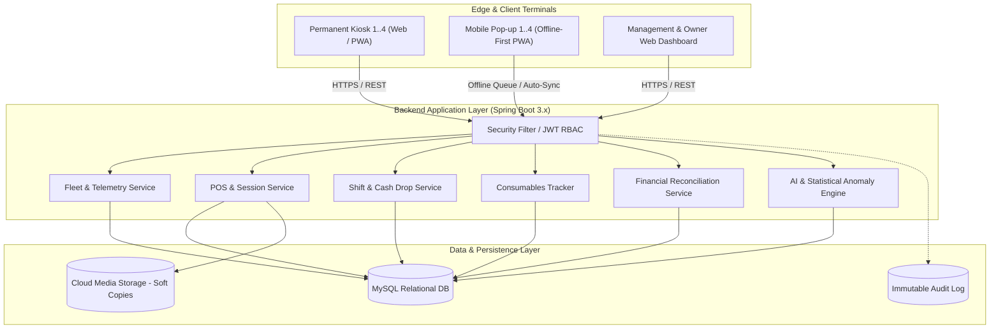
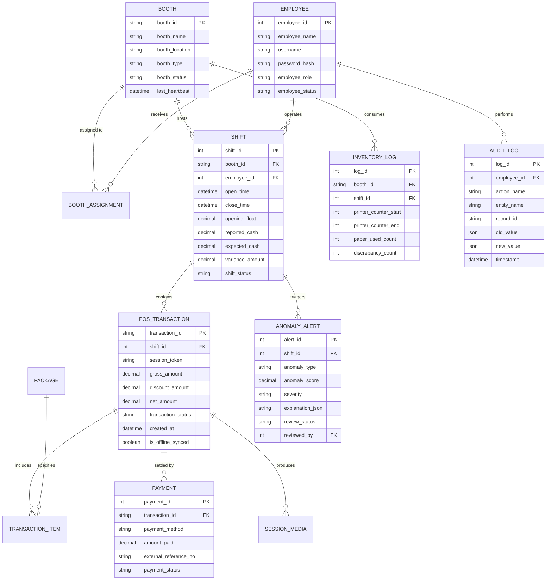

# SOFTWARE REQUIREMENTS SPECIFICATION (SRS)
## SmartBooth: Intelligent Multi-Location Photobooth Fleet, POS, and Revenue Monitoring System
**Document Version:** 2.0 (Comprehensive Proposal)  
**Document Status:** Ready for Stakeholder & Project Adviser Review  
**Organization:** Memento Studios  
**Date:** October 2026  

---

### Document Control
| Item | Description |
| :--- | :--- |
| **Document Title** | Software Requirements Specification — SmartBooth |
| **System Code** | SB-MS-2026 |
| **Version** | 2.0 |
| **Previous Version** | 1.0 (Draft) |
| **Client / Organization** | Memento Studios |
| **Technology Target** | Spring Boot (Java 21), MySQL, React Web Client, Progressive Web App (PWA) |
| **Approval Authorities** | Project Adviser, Lead System Architect, Memento Studios Business Owner |

---

## 1. Introduction

### 1.1 Purpose
This document specifies the software requirements for **SmartBooth**, a centralized enterprise fleet management, cloud point-of-sale (POS), and automated revenue monitoring platform developed for **Memento Studios**. The system addresses revenue leakage, inventory discrepancy, unrecorded cash transactions, and operational blind spots across distributed permanent studio kiosks and mobile pop-up event photobooths.

### 1.2 Business Problem & Motivation
Photobooth operations are highly susceptible to revenue shrinkage and operational friction:
1. **Unrecorded Cash Sessions:** Attendants running sessions for cash and failing to enter them into the POS.
2. **Shift Attribution Gaps:** Multiple staff members sharing a terminal without individual cash drawer reconciliation (blind cash drops).
3. **Hardware & Consumable Disconnect:** Physical consumables (sublimation dye-sub ribbons and photo paper rolls) being consumed without matching POS transaction entries.
4. **Network Instability at Pop-up Events:** Remote venues lacking reliable internet, leading to operational downtime or unlogged transactions.
5. **Lack of Automated Anomaly Detection:** Manual auditing of logs across 8+ locations is labor-intensive and delayed, preventing timely fraud interventions.

### 1.3 Scope of the System
SmartBooth standardizes fleet operations across **eight (8) initial photobooth units** (expandable to arbitrary fleet sizes), categorized into:
- **Permanent Kiosks (4 units):** Fixed mall and studio locations with continuous AC power and fixed internet.
- **Mobile Pop-up Event Booths (4 units):** Deployable for private bookings (weddings, corporate activations, parties) requiring offline-capable booking fulfillment and shift tracking.

#### Core Subsystems:
1. **Fleet & Booth Device Monitoring:** Telemetry, health heartbeats, remote status, maintenance logs.
2. **Hybrid POS & Session Management:** Walk-in checkout, scheduled event packages, add-ons, digital receipting, and offline-first queue synchronization.
3. **Cashier Shift & Float Reconciliation:** Blind cash drops, drawer float tracking, and handover discrepancy logs.
4. **Consumables & Hardware Tracking:** Photo paper and ribbon counter tracking against recorded prints.
5. **Multi-Method Financial Reconciliation:** Discrepancy flagging across Cash, E-Wallet (GCash, Maya), Card, and Bank Transfers with proof reference verification.
6. **AI-Assisted Anomaly Detection Engine:** Automated statistical and rule-based outlier scoring to catch ghost sessions, refund spikes, and cash ratio anomalies.
7. **Role-Based Access Control (RBAC) & Immutable Audit Trail:** Tamper-evident activity logs for all financial mutations.
8. **Digital Media Cloud Vault:** QR code generation for customer soft-copy retrieval linked to session IDs.

### 1.4 Intended Audience & Stakeholders
- **System Administrators:** Fleet configuration, system parameters, credential provisioning.
- **Business Owners / General Managers:** Revenue performance analytics, anomaly investigations, pricing/package configuration.
- **Location Supervisors:** Daily cash reconciliation, consumable restocks, shift sign-offs.
- **Booth Attendants / Cashiers:** Walk-in session entry, payment processing, shift handover.
- **Academic / Project Advisers:** Verification of software engineering principles, system architecture, and algorithmic validity.

### 1.5 Definitions, Acronyms, and Abbreviations
| Term | Definition |
| :--- | :--- |
| **POS** | Point of Sale system used by booth attendants to log sales transactions. |
| **Blind Cash Drop** | A reconciliation procedure where the cashier counts and enters physical cash without knowing the system-calculated expected total beforehand. |
| **Consumable Delta** | The difference between physical paper/ribbon decrement and billable session print count. |
| **Ghost Session** | A photobooth capture/print cycle executed physically without a matching financial transaction in the POS. |
| **Heartbeat** | A periodic telemetry signal (ping) sent by the booth terminal to indicate operational readiness. |
| **Isolation Forest** | An unsupervised machine learning algorithm used for identifying anomalies in multivariate transaction data. |
| **Offline-First PWA** | Web application designed to function without an active internet connection using local caching and background sync. |
| **RBAC** | Role-Based Access Control enforcing least-privilege principles. |

---

## 2. Overall Description

### 2.1 Product Perspective & Context
SmartBooth functions as a centralized distributed web architecture. Attendant-facing POS terminals operate as Progressive Web Applications (PWA) running on booth tablets or mini-PCs, communicating via authenticated REST APIs with a central Spring Boot microservice backed by a relational database (MySQL) and an asynchronous analytics/anomaly engine.

### 2.2 Operational Models
1. **Walk-In Model (Permanent Mall/Studio Kiosks):**
   Customer selects package $\rightarrow$ Attendant registers session in POS $\rightarrow$ Payment received (Cash / GCash / Card) $\rightarrow$ Photo session triggered $\rightarrow$ Prints issued $\rightarrow$ Digital copy delivered via QR code.
2. **Event Booking Model (Pop-up Booths):**
   Advance booking registered by manager $\rightarrow$ Deposit recorded $\rightarrow$ Booth dispatched $\rightarrow$ Attendant starts Event Session Mode (unlimited prints or pre-set quota) $\rightarrow$ Balance settled on-site $\rightarrow$ Shift closed at event conclusion.

### 2.3 User Classes & Persona Matrix
| User Role | Responsibilities | Access Boundaries |
| :--- | :--- | :--- |
| **Super Administrator** | System config, user provisioning, global overrides, database backups. | Unrestricted system-wide access. |
| **Business Owner / General Manager** | Strategic BI analytics, financial reconciliation, anomaly investigation sign-off, package pricing. | All financial and audit reports; no terminal-level session creation. |
| **Area Supervisor** | Shift verification, physical consumable replenishment, cash drop approvals. | Multi-booth operational oversight within assigned geographic cluster. |
| **Booth Attendant / Cashier** | Recording sessions, issuing receipts, performing shift open/close, logging consumable loading. | Restricted to assigned booth during active shift window only. |

---

## 3. Detailed Specific Requirements

### 3.1 Module 1: Fleet & Booth Infrastructure Management
- **FR-BOOTH-01 (Unique Fleet Identity):** The system shall register each photobooth with a globally unique `booth_id`, friendly nickname, hardware MAC address, asset serial number, and assigned operational type (`PERMANENT_KIOSK` vs `POPUP_EVENT`).
- **FR-BOOTH-02 (Operational State Machine):** The system shall maintain real-time status transitions: `ONLINE`, `OFFLINE`, `IN_SESSION`, `MAINTENANCE`, `DECOMMISSIONED`.
- **FR-BOOTH-03 (Heartbeat Telemetry):** Connected booth terminals shall transmit an automated telemetry heartbeat ping every 120 seconds, containing terminal timestamp, active software version, and hardware connectivity status.
- **FR-BOOTH-04 (Location & Event Assignment):** The system shall bind each booth to either a permanent geographical location (with GPS coordinates and operating hours) or an active Event Booking schedule.
- **FR-BOOTH-05 (Maintenance & Incident Log):** The system shall provide an incident management register to record hardware malfunctions (camera error, printer jam, payment terminal fault), technician dispatch, and resolution sign-offs.

### 3.2 Module 2: Point of Sale (POS) & Session Lifecycle
- **FR-POS-01 (Unique Session Token):** The system shall generate a cryptographically non-sequential transaction number (`TRX-YYYYMMDD-XXXXX`) and associated `session_id` upon checkout initiation.
- **FR-POS-02 (Dynamic Catalog & Pricing Engine):** The system shall compute total checkout amounts based on base package selected, quantity of prints, specialty paper/frames, digital-only add-ons, and authorized promotional discount codes.
- **FR-POS-03 (Split & Multi-tender Payment):** The system shall support split-tender payments across multiple channels:
  - Cash (with automatic calculation of change given).
  - E-Wallet (GCash, Maya) with mandatory manual or scanned payment reference number entry.
  - Credit/Debit Card terminal authorization reference.
  - Pre-paid Event Voucher code.
- **FR-POS-04 (Digital & Printed Receipt Generation):** The system shall generate thermal-printer compliant receipts and dynamic QR codes allowing customers to view and download their digital receipt on their personal mobile devices.
- **FR-POS-05 (Tamper Prevention & Transaction Immutability):** Once a transaction reaches `COMPLETED` status, it shall become read-only. It cannot be edited or deleted.
- **FR-POS-06 (Authorized Void / Refund Workflow):** Any void or refund request shall require supervisor/manager credential authorization (or OTP verification) and mandatory selection of a structured reason code (e.g., `PRINTER_DEFECT`, `CUSTOMER_CANCELLATION`, `DUPLICATE_ENTRY`).

### 3.3 Module 3: Cashier Shift Management & Blind Cash Reconciliation *(Critical Anti-Fraud)*
- **FR-SFT-01 (Shift Initialization):** Prior to recording any transaction, an attendant must open a shift by verifying their identity and inputting the starting physical cash drawer amount (`cash_float`).
- **FR-SFT-02 (Exclusive Drawer Ownership):** Only one active shift per booth terminal shall be permitted at any given time. Transactions cannot be logged without an open shift.
- **FR-SFT-03 (Mid-Shift Cash Skim / Drop):** The system shall allow authorized supervisors to record mid-shift cash drops (transferring excess cash from booth drawer to safe) with counter-signatures from both attendant and supervisor.
- **FR-SFT-04 (Blind Shift Close):** Upon shift termination, the attendant shall count and submit the total physical cash in the drawer without the system displaying the expected total (*blind drop*).
- **FR-SFT-05 (Variance Calculation & Explanation):** Once the blind count is submitted, the system shall compute:
  $$\text{Variance} = \text{Actual Cash Submitted} - (\text{Opening Float} + \text{Total Cash Sales} - \text{Cash Drops})$$
  Any variance exceeding configured threshold (e.g., $\pm 20.00$ PHP) shall mandate the cashier to submit an immediate incident statement prior to shift lock.

### 3.4 Module 4: Consumables & Physical Counter Reconciliation *(Hardware Cross-Check)*
- **FR-INV-01 (Roll & Ribbon Inventory Tracking):** The system shall track remaining paper print capacity and ribbon usage per booth.
- **FR-INV-02 (Consumable Loading Log):** When replacing consumables, attendants shall log the pack serial number, loaded capacity (e.g., 700 prints per roll), and replacement timestamp.
- **FR-INV-03 (Hardware Counter vs. POS Audit):** The system shall record the physical printer print count counter at shift open and shift close.
- **FR-INV-04 (Consumable Shrinkage Alert):** The system shall calculate the discrepancy:
  $$\Delta_{\text{Consumables}} = (\text{Printer Counter Start} - \text{Printer Counter End}) - \text{Total Recorded Billable Prints}$$
  If $\Delta_{\text{Consumables}} > \text{Allowed Waste Threshold}$ (e.g., $>3$ prints for alignment test), the system shall trigger an unrecorded print alert.

### 3.5 Module 5: Offline-First Operation & Queue Synchronization *(Event Resilience)*
- **FR-OFF-01 (Local Session Persistence):** In the event of internet disconnection, the client POS (PWA) shall transition transparently to `OFFLINE_MODE`, storing transactions and receipts in encrypted local browser storage (IndexedDB).
- **FR-OFF-02 (Offline Cryptographic Stamping):** Offline transactions shall be signed with a local terminal cryptographic hash incorporating previous transaction hash to prevent offline replay or deletion.
- **FR-OFF-03 (Automated Sync on Reconnect):** When network connectivity is re-established, the POS shall automatically dispatch queued offline transactions sequentially with conflict resolution.
- **FR-OFF-04 (Offline Cap Limit):** The system shall restrict offline operations to a configurable safety limit (e.g., maximum 50 transactions or 4 hours without sync) before requiring supervisor authorization or network check-in.

### 3.6 Module 6: Financial Monitoring & Revenue Reconciliation
- **FR-FIN-01 (Multi-Dimension Aggregation):** The system shall aggregate gross revenue, net revenue, discounts, taxes, and refunds across:
  - Specific booth or fleet-wide.
  - Date ranges (hourly, daily, weekly, monthly, annual).
  - Event bookings vs walk-in kiosk operations.
  - Payment channel (Cash vs GCash vs Maya vs Card).
- **FR-FIN-02 (Bank & E-Wallet Reconciliation):** The system shall provide an import interface (CSV / API) for GCash/Maya merchant settlement statements to automatically match customer reference numbers against recorded POS entries.
- **FR-FIN-03 (Discrepancy Investigation Workflow):** Discrepancies flagged by the system shall be routed into a management investigation queue with status tracking (`OPEN`, `INVESTIGATING`, `JUSTIFIED`, `EMPLOYEE_DEDUCTION`, `WRITTEN_OFF`).

### 3.7 Module 7: AI-Assisted Anomaly Detection Engine
- **FR-AI-01 (Statistical Outlier Detection - Z-Score / IQR):** The system shall calculate running baselines for transaction velocity, average basket size, and cash-to-digital payment ratios per booth. Any hourly transaction batch deviating by $> 2.5\sigma$ from expected distribution shall trigger an anomaly warning.
- **FR-AI-02 (Isolation Forest Clustering):** The system shall feed daily feature vectors into an unsupervised Isolation Forest model to detect subtle multidimensional patterns:
  - Features: $[ \text{Cash Ratio}, \text{Void Rate}, \text{Average Session Duration}, \text{Prints-to-Session Ratio}, \text{Hour-of-Day Distribution} ]$.
- **FR-AI-03 (Deterministic Fraud Heuristics):** The system shall flag immediate high-priority alerts for:
  - **Pattern A (Consecutive Voids):** $\ge 3$ voids logged within 30 minutes of shift closing.
  - **Pattern B (Ghost Print Inconsistency):** Printer consumable count decreasing with zero registered transactions during the same timeframe.
  - **Pattern C (Off-Hour Sessions):** Transactions recorded outside authorized venue operating hours.
  - **Pattern D (Velocity Anomaly):** Rapid back-to-back transactions with duration $< 45$ seconds for multi-shot photo packages.
- **FR-AI-04 (Explainable AI Anomaly Dashboard):** Each detected anomaly shall present an explainability card showing the anomaly score, contributing risk factors, historical comparison graphs, and attendant on duty.

### 3.8 Module 8: Customer Soft-Copy Cloud Vault
- **FR-MED-01 (Session Media Upload):** Upon session completion, high-resolution photo strips and animated GIFs/MP4s shall be uploaded to secure cloud storage (AWS S3 or Cloudflare R2).
- **FR-MED-02 (Customer QR Access):** The printed receipt shall include an encrypted, time-limited QR code granting access to the customer's personal web download portal.
- **FR-MED-03 (Data Privacy & Retention Policy):** In compliance with data privacy regulations, customer media files shall be automatically purged from active cloud storage after a configurable duration (e.g., 30 days) with customer consent notices.

### 3.9 Module 9: Auditability & Security
- **FR-AUD-01 (Append-Only Audit Trail):** Every administrative action, shift closing, price modification, void request, and login attempt shall be recorded in an immutable, append-only database table.
- **FR-AUD-02 (Audit Record Schema):** Audit entries shall capture `log_id`, `user_id`, `role`, `ip_address`, `device_fingerprint`, `action_type`, `entity_name`, `entity_id`, `before_state_json`, `after_state_json`, and `server_timestamp`.
- **FR-AUD-03 (Tamper Detection):** Audit logs shall include cryptographic hashing of preceding records (hash-chaining) to ensure that manual database modifications are immediately detectable.

---

## 4. Non-Functional Requirements (NFRs)

### 4.1 Security Requirements
- **NFR-SEC-01 (Authentication & Session Tokens):** The system shall authenticate users via Spring Security 6 utilizing JSON Web Tokens (JWT) signed with HMAC-SHA512 or RSA-256. Access tokens shall expire in 60 minutes; refresh tokens shall expire in 12 hours with revocation capability.
- **NFR-SEC-02 (Password Hashing):** All stored credentials shall be hashed using BCrypt with a minimum work factor of 12.
- **NFR-SEC-03 (Transport Layer Security):** All communication between edge clients and the backend shall be strictly enforced over HTTPS utilizing TLS 1.3.
- **NFR-SEC-04 (Principle of Least Privilege):** API endpoints shall enforce method-level role authorization (`@PreAuthorize("hasRole('ADMIN')")`).

### 4.2 Performance & Scalability
- **NFR-PERF-01 (POS Transaction Latency):** 95% of POS checkout completions shall respond within $\le 350\text{ ms}$ under a load of 100 concurrent active terminals.
- **NFR-PERF-02 (Dashboard Query Performance):** Daily and monthly revenue aggregation dashboards shall render within $\le 1.5\text{ seconds}$ for historical datasets spanning up to 500,000 transactions.
- **NFR-PERF-03 (Anomaly Scoring Throughput):** End-of-shift anomaly analysis batch jobs shall complete execution within $\le 30\text{ seconds}$ of shift closure.

### 4.3 Availability & Fault Tolerance
- **NFR-REL-01 (System Availability):** The cloud backend shall achieve $99.5\%$ uptime during operating hours (10:00 AM – 11:00 PM local time).
- **NFR-REL-02 (Database Recovery Point Objective / RPO):** Automated database snapshot backups shall occur every 6 hours with transaction binary logging, ensuring an RPO of $\le 15\text{ minutes}$ in disaster recovery.
- **NFR-REL-03 (Database Recovery Time Objective / RTO):** Total recovery time from server failure to active service restoration shall not exceed 60 minutes.

### 4.4 Usability & Ergonomics
- **NFR-USE-01 (Touchscreen Optimization):** The POS user interface shall feature large touch targets (minimum $48 \times 48\text{ dp}$) tailored for 10-inch to 15-inch tablet screens.
- **NFR-USE-02 (Transaction Speed):** The walk-in checkout workflow shall require $\le 4$ touchscreen interactions from package selection to receipt generation.

---

## 5. Refined Data Architecture & Relational Entities

Below is the normalized relational schema mapping core entities, primary keys, and foreign relationships:

---

## 6. System Interfaces & Constraints

### 6.1 Hardware & Peripheral Interfaces
- **Receipt Printers:** Support for ESC/POS thermal printers over USB and Bluetooth.
- **Photo Printers:** Polling hardware print spool counters (e.g., DNP RX1HS / Citizen CY-02 status monitoring).
- **Payment Terminals:** Integration with QR Ph static/dynamic display standards for seamless mobile e-wallet payments.

### 6.2 External Software Interfaces
- **Cloud Storage:** Amazon S3 / Cloudflare R2 compatible object store for customer photo uploads.
- **Messaging / Notification Service:** Mailgun / Twilio SendGrid for discrepancy alerts delivered to management.

### 6.3 Technical Implementation Constraints
- Backend: Java 21, Spring Boot 3.5.x, Spring Data JPA / Hibernate, Spring Security.
- Database: MySQL 8.0+ with InnoDB storage engine.
- Edge Architecture: Progressive Web App with IndexedDB client caching.
- Fleet Scope: 8 units initial release (4 Kiosks, 4 Pop-ups), expandable without schema modifications.

---

## 7. Requirements Verification & Test Traceability Matrix

| Requirement ID | Verification Method | Pre-conditions | Test Steps & Input | Expected System Output |
| :--- | :--- | :--- | :--- | :--- |
| **FR-BOOTH-01** | Negative Functional Test | Booth `BTH-01` already exists in DB. | Attempt to register new booth with `booth_id = 'BTH-01'`. | System throws `DuplicateResponseException` (409 Conflict) with descriptive message. |
| **FR-SFT-04** | Blind Drop Test | Active shift with `float = 1000`, `cash sales = 2500`. Total expected = `3500`. | Attendant enters `reported_cash = 3300` without seeing expected amount. | System records shift with `variance_amount = -200`, flags shift status as `VARIANCE_DETECTED`, prompts for mandatory statement. |
| **FR-INV-04** | Consumable Cross-Check | Shift logs 10 transactions (2 prints each = 20 prints). | Physical printer counter records start: 100, end: 125 ($\Delta = 25$ prints). | System identifies 5 unrecorded prints ($\Delta > 3$ allowance) and generates `ANOMALY_ALERT` for inventory shrinkage. |
| **FR-OFF-01** | Offline Resilience Test | Device network interface disconnected. | Attendant completes 2 walk-in transactions. | Transactions saved locally in IndexedDB with cryptographic chaining; receipt generated with offline indicator watermark. |
| **FR-OFF-03** | Auto-Sync Test | Reconnect network on previously offline device. | System background service detects network restore. | Transactions synced to cloud backend in chronological sequence; status updated to `SYNCED` without primary key collisions. |
| **FR-AI-03** | Anomaly Detection Test | Active shift with 3 completed transactions. | Attendant executes 3 consecutive voids within 10 minutes. | Immediate High-Severity Alert triggered: `CONSECUTIVE_VOIDS_BEFORE_CLOSE` sent to Management Dashboard. |
| **NFR-SEC-01** | Security Test | Expired JWT token ($>60$ minutes old). | Send `GET /api/v1/revenue/summary` with expired Bearer token. | System returns `401 Unauthorized` with clear token expiration code. |

---

## 8. Stakeholder Confirmation & Sign-Off Matrix

The following table records the formal validation of this specification:

| Stakeholder Role | Name & Title | Signature | Date |
| :--- | :--- | :--- | :--- |
| **Project Adviser** | [ Academic / Technical Adviser ] | ____________________ | ____ / ____ / 2026 |
| **Memento Studios Representative** | [ Business Owner / Operations Lead ] | ____________________ | ____ / ____ / 2026 |
| **Student Project Lead** | [ Lead Systems Analyst / Developer ] | ____________________ | ____ / ____ / 2026 |
